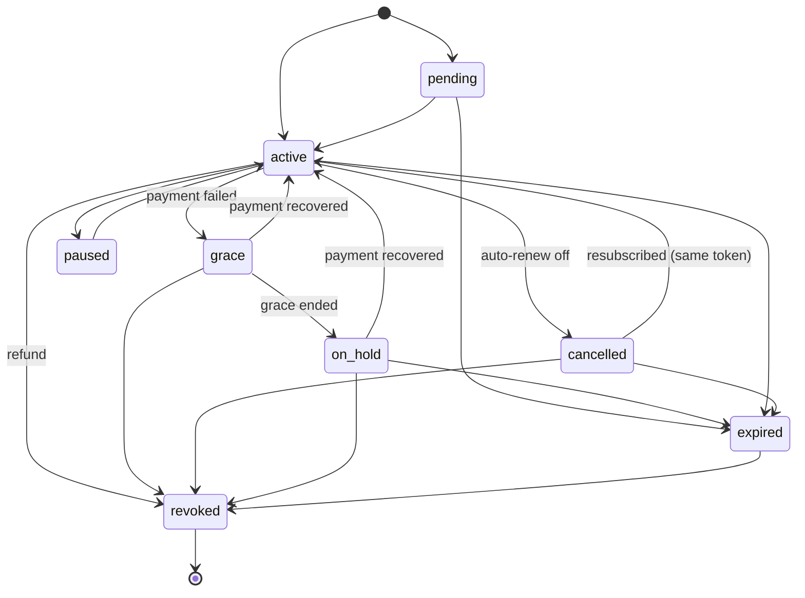

# Purchase state machine

The state is always Google's (`subscriptionsv2.subscriptionState`, mapped in `fromSubscriptionV2`). The server never derives it from the client, and only changes it in three ways:
- keeping a terminal state;
- ending a superseded token;
- forcing `revoked` on a refund notification.

## States and access

| State | Google state | Pro access (`accessUntil`) |
|---|---|---|
| `pending` | `SUBSCRIPTION_STATE_PENDING` | None |
| `active` | `ACTIVE` | Until `expiresAt` (a valid future date is required) |
| `cancelled` | `CANCELED` (auto-renew off) | Until `expiresAt` |
| `grace` | `IN_GRACE_PERIOD` | The later of `expiresAt` and the next UTC midnight + 3 days; moved on by each read |
| `on_hold` | `ON_HOLD` | None |
| `paused` | `PAUSED` | None |
| `expired` | `EXPIRED` | None |
| `revoked` | refund (`SUBSCRIPTION_REVOKED`, voided current order) | None. **Terminal** |
| anything else | unknown | Mapped to `pending` (no access); an unknown state in a store answer is rejected |

A store answer in `active`, `cancelled`, `grace`, `on_hold` or `paused` with no valid expiry is rejected outright, so a missing date can never mean "forever".

## Transitions

Google defines which transitions happen. The server accepts any transition reported by a fresh read, with three rules on top:

1. **Terminal:** once `revoked`, always `revoked` for that token.
2. **Superseded:** once a replacement purchase that names this token in `linkedPurchaseToken` grants access, this token is `expired` for good.
3. **Monotonic:** an answer requested before the last applied one is ignored, except a refund, which always applies.

## Side effects

| Change | Purchase row | Subscription row | Grants | Audit |
|---|---|---|---|---|
| First answer that grants access | created/updated | created (`current_period_end` = access end) | one per plan feature, `valid_until` = access end | `grant` |
| Still granting, new access end | updated | `status`, `current_period_end` | `valid_until` | `plan_change` |
| Stops granting (expired/on_hold/paused/pending) | updated | `status` | `status = expired` or `revoked` | `expire` / `revoke` |
| Refund | `revoked` | `revoked`, `cancelled_at` | `revoked` | `revoke` |
| Same answer again | `last_verified_at` only | nothing | nothing | nothing |
| Replacement grants access | the old token `expired` | old `expired` | old grants `expired` | `expire` (reason `…:replaced`) |

## Plan resolution

- `currentPlan`: the most recently started subscription with status `active`, `grace` or `cancelled` and `current_period_end` in the future. It reads the database only.
- Gated routes read the active grants with `valid_until` in the future. These are cached for 60 s.
